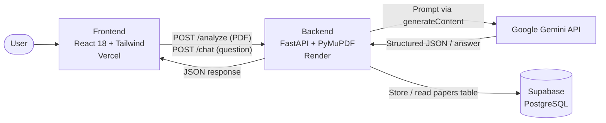

## VerifiSci – Scientific Provenance Platform

VerifiSci is a web app that helps researchers check what a scientific paper actually claims and whether the paper's own text supports those claims. Upload a PDF and VerifiSci extracts the dataset, models, experimental settings, reported results and key claims, flags claims that are contradicted or unverifiable, produces a reproducible workflow, and lets you chat with the paper.

## Live demo: https://verifisci-frontend.vercel.app/
Important – cold start: the backend is hosted on a free Render instance that goes to sleep when idle. The first request after inactivity can take 1–2 minutes while the server wakes up. Please be patient on the first upload or chat message; subsequent requests are fast (analysis of a full paper itself takes roughly 30–90 seconds).

## Table of Contents

- Features
- Architecture
- Tech Stack
- Backend Implementation
- Frontend Implementation
- API Reference
- Data Model
- Getting Started
- Deployment
- Known Limitations & Roadmap

## Features

- PDF ingestion – drag-and-drop or select a research paper PDF.
- Structured analysis – automatically extracts:
                        - Research domain
                        - Dataset (name, size, source, splits, notes)
                        - Models and versions
                        - Experimental settings (optimizer, learning rate, batch size, epochs, seed, hardware)
                        - Reported results with a match/mismatch status
                        - Traceable evidence and a step-by-step reproducible workflow
                        - Related work suggestions
- Claim verification – every detected claim is labelled verified or mismatch, with its location in the paper and supporting evidence. Mismatches are listed in a dedicated panel.
- Paper Assistant chat – ask questions about the paper; answers are grounded strictly in the paper's text with section citations, or the assistant replies NOT FOUND in this paper.
- Save & export – save a project to the session list and export a text report of the claims.
- Light/dark theme, responsive layout, toast notifications and a settings panel for the backend URL.
- Resilient LLM calls – retries with exponential backoff and automatic model fallback.

## Architecture

## Flow of an analysis
- The user uploads a PDF in the browser.
- The frontend sends it as multipart/form-data to POST /analyze.
- The backend extracts the text with PyMuPDF, builds a prompt containing a strict JSON schema plus the paper text, and calls Gemini.
- The JSON response is parsed, stored in Supabase together with the full text and SHA-256 hash, and returned to the client along with a paper_id.
- For chat, the frontend sends paper_id + question to POST /chat; the backend loads the stored text and asks Gemini to answer only from it.

## Tech Stack

| Layer | Technology |
|---|---|
| Frontend | React 18 (UMD build + in-browser Babel), Tailwind CSS (CDN), Font Awesome, Source Sans 3 |
| Backend | Python, FastAPI, Pydantic, Requests |
| PDF parsing | PyMuPDF (`fitz`) |
| LLM | Google Gemini via the REST `generateContent` endpoint |
| Database | Supabase (PostgreSQL) |
| Hosting | Vercel (frontend), Render (backend) |

## Hosting & Services

| Role | Service | Notes |
|---|---|---|
| Frontend hosting | **Vercel** | Static single-page app, live at https://verifisci-frontend.vercel.app/ |
| Backend hosting | **Render** | FastAPI web service at https://verifisci.onrender.com. Free tier sleeps when idle, so the first request can take 1–2 minutes |
| AI engine | **Google Gemini** | Called through the REST `generateContent` API for analysis and chat |
| Database | **Supabase** | PostgreSQL `papers` table storing the extracted text, hash and analysis |

## Backend Implementation

The whole backend lives in a single FastAPI file (e.g. main.py). Its major components:

## 1. Forced IPv4 resolution
Render's network can fail on IPv6 DNS lookups. The backend monkey-patches socket.getaddrinfo so every lookup uses AF_INET. This fixes connectivity to Supabase and the Gemini API.

## 2. App & CORS middleware
CORSMiddleware only allows the deployed frontend (https://verifisci-frontend.vercel.app) and http://localhost:8000 for local development. Add your own origins here if you host the frontend elsewhere.

## 3. Configuration & clients
Configuration comes from environment variables (see Getting Started). A Supabase client is created at startup when SUPABASE_URL and SUPABASE_KEY are present. The primary and fallback model names are defined as constants (PRIMARY_MODEL, FALLBACK_MODEL) and can be changed to any Gemini model available to your API key.

## 4. Analysis schema prompt (ANALYSIS_SCHEMA)
A prompt template instructs the model to return only valid JSON in a fixed shape (domain, dataset, models, settings, results, evidence, workflow, claims, relatedWork). Key rules baked into the prompt:
- A claim is verified only if the paper's own text fully supports it.
- Anything contradicted or unverifiable is marked mismatch, with the reason in evidence.
- If the paper has no experiments, fields are filled with "not reported".

## 5. Helper functions
| Function | Purpose |
|---|---|
| `extract_pdf(raw)` | Opens the PDF from bytes with PyMuPDF, joins the text of all pages, and returns page count, text and SHA-256 hash. |
| `parse_json_loose(s)` | Strips accidental Markdown code fences from the LLM output and parses JSON. |
| `ask_llm(prompt, retries=5)` | Calls Gemini with retries. On HTTP 429/500/503 it waits using **exponential backoff with jitter** (2s, 4s, 8s…). On 400/403/404 it gives up on that model immediately and tries the **fallback model**. If everything fails it returns a friendly `503` error. |

## 6. Endpoints
- GET /health – liveness check; reports whether the LLM key and database URL are configured.
- GET /test-dns – diagnostic that resolves the Supabase hostname (useful for debugging Render networking).
- POST /analyze – validates the upload (max 50 MB, must contain at least 100 characters of extractable text,  otherwise a 422 suggests OCR is needed), truncates the text to the first 90,000 characters for the prompt, runs the LLM, generates a 12-character paper_id, saves the record in Supabase and returns the analysis.
- POST /chat – fetches the stored paper by paper_id (404 if not found) and asks Gemini to answer strictly from the paper, cite the section, and respond NOT FOUND in this paper when unsupported.

## Frontend Implementation

The frontend is a single index.html using React via CDN and Babel standalone, so it needs no build step.

## Component overview
| Component | Responsibility |
|---|---|
| `App` | Holds the logged-in user. Shows `LoginScreen` until a user exists, then `Dashboard`. |
| `LoginScreen` | Demo-only login form. Any email/password is accepted; no real authentication is performed. |
| `Dashboard` | The main application: state management, API calls, layout, and all panels (see below). |
| `Modal` | Reusable overlay used for Settings, Export, Save confirmation and claim details. |
| `Toast` | Auto-dismissing success/error notification (3.5 s). |
| Icon helpers | Small wrappers around Font Awesome classes (`SearchIcon`, `Flask`, `Database`, …). |

## Dashboard internals
- Theming – THEMES defines light and dark CSS-variable palettes applied inline on the root element; all components style themselves via var(--…), so toggling dark mode is instant.
- Upload (handleFile) – validates a 20 MB client-side limit, builds a FormData, POSTs to /analyze, then maps the backend response (models → modelVersions, settings → experimentalSettings, results → reportedResults, etc.) into the shape the UI renders. Errors from the API (detail) are surfaced via toast and chat.
- Drag & drop – the upload zone handles dragover, dragleave and drop, with a highlighted state.
- Analysis overview – cards for Related Work, Dataset, Models, Experimental Settings, a Results table (Reported vs Reproduced vs Status), and the numbered Reproducible Workflow.
- Claims panels – Detected Claims (click a claim to open a detail modal with text, location and evidence) and Mismatched Claims (highlighted in amber).
- Chat widget (sendChat) – floating Paper Assistant. Requires an uploaded paper (currentPaperId); sends the question to /chat, shows a "Thinking…" indicator and auto-scrolls to the latest message.
- Save / Export – saveProject keeps a list of analysed papers for the session; doExport downloads a plain-text report (file name, domain and all claims with status and location). A confirmation modal appears when signing out with an unsaved paper.
- Settings – shows the user, lets you change the Backend API URL (defaults to https://verifisci.onrender.com), toggle theme, and sign out.

## API Reference

## GET /health
json
{ "ok": true, "llm": true, "database": true }

## POST /analyze
multipart/form-data with a file field (PDF).

## Response (200)
json
{
  "paper_id": "a1b2c3d4e5f6",
  "file_name": "paper.pdf",
  "pages": 12,
  "domain": "Computer Vision",
  "dataset": { "name": "...", "size": "...", "source": "...", "splits": "...", "note": "..." },
  "models": [{ "name": "...", "version": "..." }],
  "settings": { "optimizer": "...", "lr": "...", "batch": "...", "epochs": "...", "seed": "...", "hardware": "..." },
  "results": [{ "metric": "...", "reported": "...", "reproduced": "n/a", "status": "match" }],
  "evidence": ["..."],
  "workflow": ["step 1", "step 2"],
  "claims": [{ "id": 1, "status": "verified", "text": "...", "location": "...", "evidence": "..." }],
  "relatedWork": [{ "title": "...", "why": "..." }]
}
## Errors
413 file too large · 422 no extractable text · 500 database/config error · 503 LLM overloaded.

##POST /chat
json
{ "paper_id": "a1b2c3d4e5f6", "question": "What dataset was used?" }

## Response: 
{ "answer": "..." } · Errors: 404 paper not found · 500 database error · 503 LLM overloaded.

## Data Model

Supabase table papers:
| Column | Type | Description |
|---|---|---|
| `id` | text (PK) | 12-char hex paper ID |
| `name` | text | Original file name |
| `sha256` | text | Hash of the uploaded PDF |
| `text` | text | Full extracted text (used by `/chat`) |
| `analysis` | jsonb | The structured analysis returned by the LLM |

## Example SQL:
sql
create table papers (
  id text primary key,
  name text,
  sha256 text,
  text text,
  analysis jsonb,
  created_at timestamptz default now()
);

## Getting Started
## Prerequisites
Python 3.10+
A Google Gemini API key
A Supabase project with the papers table above

## Backend
bash
git clone <your-repo-url>
cd <your-repo>/backend

python -m venv venv
source venv/bin/activate        # Windows: venv\Scripts\activate
pip install fastapi uvicorn[standard] python-multipart requests pymupdf supabase pydantic

## Create the environment variables:

bash
export GEMINI_API_KEY="your-gemini-key"
export SUPABASE_URL="https://your-project.supabase.co"
export SUPABASE_KEY="your-supabase-key"

## Run:
bash
uvicorn main:app --reload --port 8000
Check it works at http://localhost:8000/health.

## Frontend
The frontend is static. Serve it with any static server:

bash
cd frontend
python -m http.server 5500
Open http://localhost:5500, sign in with any email/password, open Settings, and set the Backend API URL to http://localhost:8000.
Add your local frontend origin (e.g. http://localhost:5500) to allow_origins in the backend's CORS configuration.

## Deployment

- Backend (Render): create a Web Service from the repo, build command pip install -r requirements.txt, start command uvicorn main:app --host 0.0.0.0 --port $PORT, and add the three environment variables. Free instances sleep when idle, causing the 1–2 minute cold start mentioned above.
- Frontend (Vercel): deploy the folder containing index.html as a static site.

## Known Limitations & Roadmap

- Demo authentication: the login screen is a placeholder and does not authenticate anyone.
- Saved Projects are session-only: they live in React state and disappear on refresh. Analyses are stored in Supabase, but the Saved Projects list does not yet reload them.
- Context truncation: only the first ~90,000 characters of a paper are sent to the LLM, so very long papers may be partially analysed.
- Text-only PDFs: scanned PDFs without a text layer are rejected (OCR not yet supported).
- Verification is LLM-based: verified / mismatch labels reflect what the model judges from the paper's text; they should be treated as an aid, not ground truth. "Reproduced" values are not actually re-run experiments (shown as n/a).
- Upload limits differ: the frontend limits uploads to 20 MB, while the backend accepts up to 50 MB.
- Mismatch detail field: the UI reads mismatchDetail for mismatched claims, while the backend schema places the reason in evidence; aligning these would show the reason in the Mismatched Claims panel.
- Ideas: real authentication, persistent project history, OCR support, PDF report export, chunked/RAG analysis for long papers, and automated reproduction of results.
